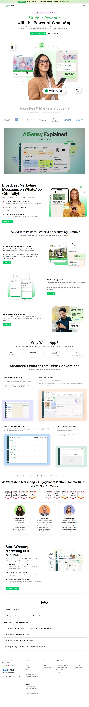

# Dealup vs AiSensy marketing-site audit

Date: 2026-08-24

## Scope

Combined UX, visual, content, conversion, accessibility-risk, and implementation audit of:

- AiSensy's current public homepage at https://aisensy.com/
- Dealup's local English homepage at `/en`
- Dealup's route structure and conversion implementation

Primary user goal: a Moroccan business owner or marketing lead should understand what Dealup does, trust it, recognize a relevant use case, and start a trial or request a demo.

## Evidence

### 1. AiSensy homepage — healthy but overloaded

AiSensy communicates the category, revenue promise, product visuals, free trial, demo, social proof, major features, trust, and objections. Its strongest conversion assets are concrete product screenshots, recognizable customer proof, a low-friction 14-day trial, repeated CTAs, and a clear Official WhatsApp/Meta association.

Its weaknesses are a very long and repetitive page, generic/hyperbolic claims (5X, 3X, #1), weak claim substantiation, inconsistent heading and body patterns, dense feature inventory, duplicated trust strips, small gray copy, and limited segmentation by buyer or local use case. The design feels assembled over time rather than governed by one tight system.

### 2. Dealup initial full-page capture — critical reveal failure

Dealup has a cleaner visual system and better semantic detail, but much of the page is initially rendered with `opacity: 0` until its viewport animation runs. In a full-page capture, large conversion sections look blank. Reduced-motion CSS shortens animation duration but does not remove the initial hidden state.

### 3. Dealup after scrolling — still missing large content regions

Even after progressive scrolling in the audit browser, large parts of the page remain visually empty in the capture. This needs to be treated as a production risk, not a screenshot quirk, until verified across normal browsers, reduced-motion mode, slow devices, back/forward navigation, and JavaScript failure.

## Dealup strengths

- Better core positioning than AiSensy: “Turn every WhatsApp conversation into a growth opportunity” is broader and more credible than an unsupported 5X promise.
- Stronger visual restraint, spacing, typography, component consistency, and brand differentiation.
- Morocco-ready localization in English, French, and Arabic, including RTL architecture.
- More honest claim handling: illustrative analytics are labeled and the customer-story placeholder avoids invented testimonials.
- Clear problem framing before the feature tour.
- Good accessibility foundations: skip link, labeled navigation, semantic tabs, visible focus styles, form labels, inline errors, status roles, and useful image alternatives.
- Clear disclosure that Meta/WhatsApp messaging fees are separate.
- Strong local opportunity: COD flows, multilingual teams, local onboarding, and Moroccan sectors can make Dealup more relevant than a generic international clone.

## Dealup critical weaknesses

1. **Most navigation and CTA destinations do not exist.** Only the root and localized homepage page files exist, while the header/footer advertise dozens of product, feature, industry, pricing, login, demo, documentation, security, and legal routes. These links currently lead to 404s.
2. **The homepage has no H1.** The hero uses the shared `Title` component whose default element is `h2`. This weakens document structure and search clarity.
3. **Scroll animation can hide the sales story.** `MotionReveal` always starts at opacity zero, including for people who prefer reduced motion. Content should be visible by default and enhanced by motion, not dependent on it.
4. **The hero can appear visually empty.** In the captured page, the background dominates while the headline, copy, CTAs, and product artwork are not visible. This destroys the five-second value test.
5. **Promised scope and visible homepage scope disagree.** Team inbox, automation, AI agents, and Moroccan solutions are implemented but commented out in the page composition. The marketing page therefore does not prove the “all AiSensy functions” proposition.
6. **The site markets unsupported or unavailable surfaces.** Payments appear throughout navigation even though the user states payments are not available. Razorpay and India-specific language remain in English navigation data, which undermines Moroccan credibility.
7. **Conversion routes are not connected.** “Start for free,” login, pricing, contact, and demo links have no corresponding pages. The final lead form depends on `NEXT_PUBLIC_API_URL`; without it, every valid submission ends in a generic error.
8. **Trust is too thin for a business-critical platform.** There are no verified customer logos, quantified Moroccan case studies, team/company identity, contact details, legal pages, data-location detail, service commitment, onboarding proof, or Meta partner evidence visible in the implementation.
9. **Pricing is too vague.** Three plan names without prices can work for enterprise sales, but they conflict with “Start for free” and do not explain limits, usage pricing, trial length, or what happens after trial.
10. **The page is still too long without strong navigation anchors.** It inherits AiSensy's feature breadth but lacks a compact persona/use-case chooser that would let e-commerce, hotels, real estate, and agencies see their path quickly.

## What to copy from AiSensy

- Product-in-context imagery that makes the WhatsApp outcome immediately recognizable.
- Dual conversion path: self-serve trial and human demo.
- Repeated CTAs after major proof sections.
- Clear onboarding-time promise.
- Objection-handling FAQ covering API access, setup, fees, message limits, and support.
- Concrete feature demonstrations rather than abstract feature labels.

## What not to copy from AiSensy

- Unsupported multiplier claims and “#1” language.
- Logo walls without context or case-study links.
- Repetitive feature sections and trust marquees.
- India-specific payment, UPI, green-tick, phone, and regulatory language.
- Treating every feature as equally important on the homepage.
- Small low-contrast gray body text and overlong pages.
- A product-first catalogue that does not guide distinct customer segments.

## Recommended Dealup positioning

Lead with local operational value, not “Moroccan AiSensy.” A defensible direction is:

> The WhatsApp growth platform built for Moroccan businesses.
> Run campaigns, qualify leads, support customers, and automate follow-up in Arabic, French, and English—from one shared workspace.

Use four proof pillars: official WhatsApp infrastructure, Moroccan onboarding/support, multilingual operation, and locally relevant workflows such as COD confirmation, appointment reminders, booking follow-up, and click-to-WhatsApp lead qualification.

## Recommended homepage sequence

1. Hero: category + Moroccan differentiation + product visual + trial/demo CTAs.
2. Trust bar: verified Meta status, local support, setup time, languages; only claims that can be proven.
3. Use-case selector: e-commerce, real estate, hotels, services/clinics, education, agencies.
4. Product story: Campaigns → Inbox → Automation → AI → Analytics, all visibly rendered.
5. One end-to-end Moroccan workflow, ideally click-to-WhatsApp or COD confirmation.
6. Verified local customer case study with baseline, result, timeframe, and customer quote.
7. Integrations relevant to Morocco; remove Razorpay unless actually supported.
8. Transparent pricing/trial explanation and Meta fee calculator or example.
9. Security, data handling, onboarding, and support proof.
10. FAQ and one final conversion action.

## Priority plan

### P0 — before publishing

- Make all content visible without animation; use motion only as progressive enhancement.
- Change the hero title to an `h1` and verify heading order.
- Remove, disable, or label every route and feature that is not available.
- Build working trial/demo/contact/login/pricing paths or change CTAs to one working lead flow.
- Connect and test the lead endpoint, including consent and privacy destination.
- Re-enable the inbox, automation, AI, and Moroccan-solutions sections if they represent shipped capabilities.

### P1 — conversion and trust

- Add verified Moroccan proof and a real company/contact/legal footprint.
- Replace generic feature lists with two or three local end-to-end stories.
- Clarify the free-trial duration, plan limits, Meta messaging fees, setup requirements, and support.
- Make payments explicitly “coming later” or omit them until launch.

### P2 — differentiation

- Create SEO landing pages for the highest-value Moroccan industries and use cases.
- Add a pricing estimator using Moroccan volume examples.
- Publish comparison and migration content without presenting Dealup as a clone.
- Add deeper product pages only when the routes contain real, useful content.

## Accessibility and evidence limits

The source shows several good accessibility practices, but screenshots and static code inspection cannot confirm full WCAG compliance. Keyboard operation, focus order, tab behavior, mobile-menu focus trapping, screen-reader announcements, zoom/reflow, color contrast in every state, form backend errors, and Arabic RTL behavior need hands-on testing. AiSensy's authenticated product and Dealup's completed dashboard were outside this audit; feature parity was not independently verified.
